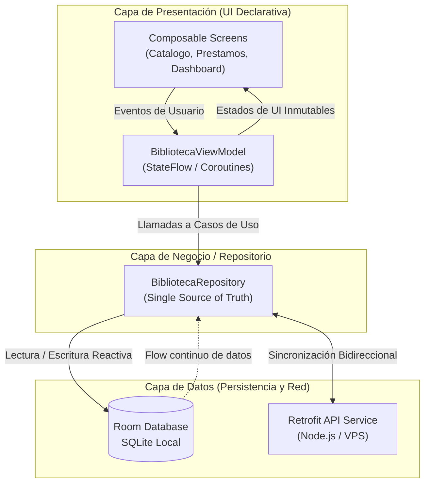
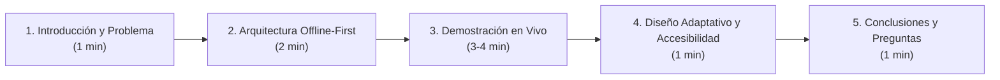

# Guía de Exposición y Defensa Técnica: Sistema Biblioteca UNAMAD

Esta guía contiene la explicación estructurada de la arquitectura, componentes críticos y decisiones técnicas del proyecto **Biblioteca UNAMAD**, diseñada para preparar una presentación sólida, clara y profesional ante docentes o jurados examinadores.

---

## 1. Ficha Técnica y Stack Tecnológico

| Componente | Tecnología | Propósito |
| :--- | :--- | :--- |
| **Lenguaje de Programación** | Kotlin 2.2+ | Lenguaje moderno, conciso y null-safe para desarrollo nativo Android. |
| **Framework de Interfaz (UI)** | Jetpack Compose + Material 3 | UI declarativa, reactiva, con sistema adaptativo de colores (Claro / Oscuro Obsidian). |
| **Patrón Arquitectural** | MVVM + Repository Pattern | Separación estricta de responsabilidades y *Single Source of Truth* (SSOT). |
| **Persistencia Local** | Room Database (SQLite) | Almacenamiento local seguro con consultas reactivas mediante `Flow`. |
| **Consumo de Servicios Web** | Retrofit 2 + OkHttp 3 | Cliente REST HTTP para sincronización remota con el servidor VPS. |
| **Asincronía y Concurrencia** | Kotlin Coroutines + StateFlow | Procesamiento en segundo plano sin bloquear el hilo principal (UI Thread). |
| **Carga de Imágenes** | Coil Compose | Carga asíncrona y almacenamiento en caché de portadas de libros. |
| **Backend de Respaldo** | Node.js + Express + TypeScript + Prisma ORM | API RESTful centralizada conectada a base de datos relacional. |

---

## 2. Arquitectura del Software (Offline-First)

El proyecto implementa la arquitectura **Offline-First**, lo que significa que la aplicación es 100% operativa incluso sin conectividad a internet. La interfaz de usuario nunca espera a que responda el servidor para mostrar datos: se alimenta en tiempo real de la base de datos local Room.



> [!IMPORTANT]
> **Punto clave para la exposición:** Cuando el jurado pregunte: *"¿Qué sucede si el estudiante pierde la conexión a internet en el campus?"*, la respuesta técnica es:  
> *"La app lee y escribe inmediatamente en la base de datos local SQLite mediante Room. Cuando la conexión se restablece, el repositorio sincroniza las transacciones con el servidor central mediante Retrofit de forma transparente y sin bloquear la experiencia del usuario."*

---

## 3. Estructura del Código y Mapa de Archivos

Todo el código fuente Android reside en `app/src/main/java/com/example/biblioteca/`:

```
app/src/main/java/com/example/biblioteca/
├── MainActivity.kt                      <-- Punto de entrada de la actividad Android
├── model/                               <-- Modelos de dominio y enumeradores
│   ├── Enums.kt
│   └── Models.kt
├── data/
│   ├── local/                           <-- Persistencia local (Room & Sesión)
│   │   ├── BibliotecaDatabase.kt
│   │   ├── dao/Daos.kt
│   │   ├── entity/Entities.kt
│   │   └── session/SessionManager.kt
│   ├── remote/                          <-- Servicios REST y red
│   │   └── api/BibliotecaApiService.kt
│   └── repository/                      <-- Repositorio (SSOT)
│       └── BibliotecaRepository.kt
├── ui/
│   ├── theme/                           <-- Sistema de Diseño y Temas Visuales
│   │   ├── Color.kt
│   │   ├── Theme.kt
│   │   └── Type.kt
│   ├── navigation/                      <-- Enrutamiento y barra de navegación
│   │   └── BibliotecaApp.kt
│   ├── viewmodel/                       <-- Estado de la UI y lógica de presentación
│   │   └── BibliotecaViewModel.kt
│   ├── screens/                         <-- Pantallas completas de la aplicación
│   │   ├── CatalogoScreen.kt
│   │   ├── PrestamosScreen.kt
│   │   ├── GestionSolicitudesScreen.kt
│   │   ├── DashboardScreen.kt
│   │   ├── PerfilEstudianteScreen.kt
│   │   ├── LoginScreen.kt
│   │   ├── RegistroEstudianteScreen.kt
│   │   └── PanelInventarioDatabaseScreen.kt
│   ├── dialogs/                         <-- Modales y ventanas interactivas
│   │   ├── Dialogs.kt                   <-- DigitalViewerDialog, RegistroLibro, NuevoPrestamo
│   │   ├── GestionMultasDialog.kt
│   │   ├── ReportesDialog.kt
│   │   ├── SolicitarPrestamoDialog.kt
│   │   └── RechazoSolicitudDialog.kt
│   ├── components/                      <-- Componentes atómicos reutilizables
│   │   └── CommonComponents.kt
│   └── util/
│       └── PdfUrlResolver.kt            <-- Proxy y resolución de URLs de lectura PDF
```

---

## 4. Desglose Detallado de los Archivos Críticos

### 4.1. Punto de Entrada y Configuración
- **`MainActivity.kt`**:  
  Configura la actividad principal, habilita la experiencia visual *Edge-to-Edge* con barras de sistema transparentes y observa el estado reactivo `themeMode` emitido por el ViewModel para inyectar dinámicamente `BibliotecaTheme(darkTheme = ...)` en tiempo real.

### 4.2. Capa de Modelos (`model/`)
- **`Models.kt`**:  
  Define las clases de datos puras de la aplicación: `Libro`, `Prestamo`, `SolicitudPrestamo`, `Multa`, `Usuario` y `ReporteInstitucional`.
- **`Enums.kt`**:  
  Estados finitos del sistema que impiden errores tipográficos:
  - `RolUsuario`: `ESTUDIANTE`, `BIBLIOTECARIO`, `ADMINISTRADOR`.
  - `EstadoPrestamo`: `ACTIVO`, `DEVUELTO`, `VENCIDO`.
  - `EstadoSolicitud`: `PENDIENTE`, `APROBADA`, `RECHAZADA`.
  - `EstadoMulta`: `PENDIENTE`, `PAGADA`, `CONDONADA`.
  - `FormatoLibro`: `FISICO`, `DIGITAL`, `AMBOS`.

### 4.3. Capa de Datos Local (`data/local/`)
- **`Entities.kt`**:  
  Contiene las anotaciones `@Entity` de Room que mapean los objetos Kotlin a tablas SQLite (`usuarios`, `libros`, `prestamos`, `solicitudes_prestamo`, `multas`) con claves primarias e índices.
- **`Daos.kt`**:  
  Data Access Objects con consultas SQL compiladas (`@Query`, `@Insert`, `@Update`). Retornan flujos reactivos `Flow<List<T>>` que notifican cambios automáticos a la UI ante cualquier inserción o actualización.
- **`SessionManager.kt`**:  
  Maneja la persistencia de sesión del usuario en `SharedPreferences`, además de almacenar la preferencia de tema visual (`ThemeMode`: `SYSTEM`, `LIGHT`, `DARK`) para que no se pierda al cerrar sesión.

### 4.4. Capa de Repositorio (`data/repository/`)
- **`BibliotecaRepository.kt`**:  
  Es el núcleo del negocio. Coordina la base de datos local y la API remota. Aplica reglas críticas como:
  - Reducción e incremento atómico de ejemplares disponibles al prestar o devolver.
  - Cálculo automático de multas por mora (S/. 1.00 por día de retraso).
  - Poblado inicial de datos semilla (*Seeding*) si la base de datos está vacía.
  - Orquestación de sincronización con reintentos y tolerancia a fallos.

### 4.5. Capa de Presentación (`ui/viewmodel/` y `ui/navigation/`)
- **`BibliotecaViewModel.kt`**:  
  Almacena y expone el estado de la UI mediante `StateFlow`. Contiene la lógica para:
  - Autenticación con verificación de credenciales institucionales.
  - Búsqueda en vivo y filtrado reactivo del catálogo bibliográfico.
  - Gestión de préstamos, aprobaciones de solicitudes y pagos de multas.
  - Conmutación instantánea del modo de tema visual (`cambiarThemeMode`).
- **`BibliotecaApp.kt`**:  
  Estructura de navegación principal (`Scaffold`) con barra superior (`TopAppBar`), banner de estado de conectividad en tiempo real y barra de navegación inferior (`NavigationBar`). Implementa transiciones animadas horizontales con `AnimatedContent` entre pestañas.

### 4.6. Pantallas de la Interfaz (`ui/screens/`)
- **`CatalogoScreen.kt`**:  
  Catálogo con campo de búsqueda rápido (con botón para limpiar texto), filtros avanzados en un modal desplegable inferior (`ModalBottomSheet`), soporte para *Pull-to-Refresh* y visualización de tarjetas de libros (`BookCard`) con estados de disponibilidad en tiempo real.
- **`PrestamosScreen.kt`**:  
  Control de préstamos activos e históricos. Para estudiantes, organiza pestañas de "Mis Solicitudes", "En Préstamo" e "Historial". Para bibliotecarios, permite registrar devoluciones con gestos deslizables (`SwipeToDismissBox`) y retroalimentación háptica.
- **`GestionSolicitudesScreen.kt`**:  
  Panel exclusivo del bibliotecario para evaluar solicitudes de préstamo entrantes, con opciones de aprobación en un clic o rechazo con motivo justificado.
- **`DashboardScreen.kt`**:  
  Panel de control con métricas clave (títulos activos, ejemplares disponibles, préstamos vigentes, mora acumulada) y accesos directos al generador de reportes institucionales.
- **`PerfilEstudianteScreen.kt`**:  
  Credencial digital del estudiante con avatar generado, selector interactivo de tema visual (Sistema / Claro / Oscuro) y botón de cierre de sesión con diálogo de confirmación de seguridad.
- **`LoginScreen.kt` y `RegistroEstudianteScreen.kt`**:  
  Flujo de acceso seguro con validación institucional y selección de escuelas profesionales oficiales de la UNAMAD.

### 4.7. Diálogos y Modales Especializados (`ui/dialogs/`)
- **`DigitalViewerDialog.kt` (en Dialogs.kt)**:  
  Lector de libros digitales integrado en la app. Cuenta con selector de tipografía (Serif, Sans-serif, Monospace), selector de tamaño de fuente (12sp a 24sp), temas de lectura (Sepia, Papel cálido y Noche) y visor WebView alternativo para PDFs alojados en la nube.
- **`GestionMultasDialog.kt`**:  
  Módulo de finanzas para cobrar multas de lectores morosos o condonar sanciones autorizadas.
- **`ReportesDialog.kt`**:  
  Panel analítico con resumen de circulación, libros más solicitados y tasa de retorno a tiempo.

### 4.8. Sistema de Diseño (`ui/theme/`)
- **`Color.kt`**:  
  Define la paleta cromática con contraste riguroso WCAG AAA:
  - **Modo Claro**: Verde Institucional UNAMAD (`#164E3F`) y Ámbar cálido (`#D97706`).
  - **Modo Oscuro Minimalista**: Negro Obsidiana (`#0B0F17`), Slate profundo (`#121722`, `#1A2130`), acento Oro cálido (`#FBBF24`, ratio > 11:1) y textos blanco puro (`#F8FAFC`, ratio > 16:1). **Cero verde en modo oscuro.**
  - `LocalAdaptiveStatusColors`: Proveedor de composición para que los badges de estado se adapten automáticamente al tema activo.

---

## 5. Preguntas Clave del Jurado y Respuestas Técnicas

### P1: "¿Por qué se eligió Jetpack Compose en lugar de XML Views tradicional?"
> **Respuesta:**  
> *"Jetpack Compose es el kit de herramientas declarativo moderno de Google para Android. Elimina la necesidad de acoplar archivos XML con `findViewById` o ViewBinding, reduce el código repetitivo en más de un 40% y permite que la interfaz sea una función pura del estado. Al actualizar un `StateFlow`, Compose solo recomopila las partes exactas de la UI que cambiaron, garantizando 60 a 120 FPS fluidos."*

### P2: "¿Cómo se implementó la seguridad y la separación de roles en la aplicación?"
> **Respuesta:**  
> *"La seguridad se implementó mediante el enumerador `RolUsuario` (`ESTUDIANTE` y `BIBLIOTECARIO`). El `BibliotecaApp.kt` evalúa dinámicamente el rol del usuario autenticado: los estudiantes solo tienen acceso al catálogo, sus préstamos personales y su carnet digital. Las pantallas administrativas, la gestión de inventario, aprobación de solicitudes y módulo de multas están restringidas tanto en la barra de navegación como en la lógica del ViewModel."*

### P3: "¿Cómo funciona el sistema de tema claro y oscuro y dónde se guarda?"
> **Respuesta:**  
> *"El modo visual se gestiona mediante el enum `ThemeMode` (`SYSTEM`, `LIGHT`, `DARK`). Se almacena de manera persistente en `SessionManager` mediante `SharedPreferences`, lo que garantiza que la preferencia del usuario se mantenga incluso después de reiniciar la aplicación o cerrar sesión. El `MainActivity` observa este flujo y recompone el árbol de temas de Material 3 instantáneamente."*

### P4: "¿Cómo manejan los retrasos en la devolución de libros físicos?"
> **Respuesta:**  
> *"Cada préstamo tiene una fecha límite (`fechaDevolucionEsperada`). Diariamente o al momento de registrar la devolución en `BibliotecaRepository`, el sistema compara la fecha actual con la fecha esperada. Si hay retraso, genera una entidad `Multa` en estado `PENDIENTE` calculada a razón de S/. 1.00 por día de mora, bloqueando nuevos préstamos para ese alumno hasta su regularización o condonación."*

### P5: "¿Por qué no se utilizaron emojis en la interfaz gráfica?"
> **Respuesta:**  
> *"Los emojis de Unicode dependen del fabricante del dispositivo (Samsung, Xiaomi, Google Pixel, etc.) y suelen renderizarse con aspectos visuales inconsistentes o infantiles. Para otorgar una identidad institucional seria y profesional, se erradicaron al 100% los emojis y se reemplazaron por vectores de Material 3 (`Icons.Default.*` e `Icons.AutoMirrored.*`), asegurando una estética homogénea en cualquier versión de Android."*

---

## 6. Guion Recomendado para una Exposición de 7 a 10 Minutos



1. **Introducción (1 min)**:
   - Mencionar el objetivo: Modernizar y digitalizar la gestión bibliográfica de la Universidad Nacional Amazónica de Madre de Dios (UNAMAD).
   - Indicar que la solución aborda tanto libros físicos en estantería como literatura digital (PDFs).

2. **Arquitectura Técnica (2 min)**:
   - Explicar brevemente el diagrama MVVM + Room + Retrofit.
   - Resaltar la cualidad *Offline-First* y la reactividad con corrutinas y `StateFlow`.

3. **Demostración en Vivo / Código (3 a 4 min)**:
   - **Flujo Estudiante**: Iniciar sesión con cuenta de alumno, buscar un libro en el catálogo con filtros dinámicos, solicitar un ejemplar y abrir un libro digital en el visor integrado cambiando el tamaño de letra.
   - **Flujo Bibliotecario**: Iniciar sesión como personal, mostrar el panel de control (Dashboard con estadísticas), aprobar la solicitud del estudiante y mostrar la actualización en tiempo real del stock físico.

4. **Diseño y Accesibilidad (1 min)**:
   - Mostrar el conmutador de tema visual Claro / Oscuro Obsidian desde la barra superior y desde el perfil.
   - Destacar el contraste visual WCAG AAA, el nuevo logo institucional minimalista y el reemplazo de emojis por iconografía vectorial.

5. **Conclusión y Cierre**:
   - Resumir que el sistema es escalable, modular, mantenible y listo para producción académica.
   - Invitar al jurado a realizar sus preguntas.
