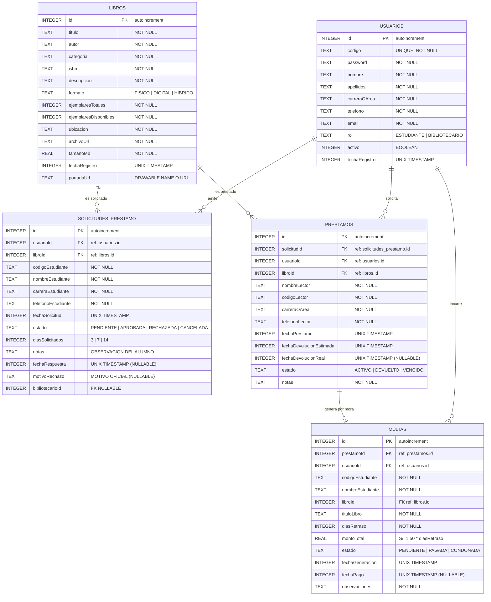
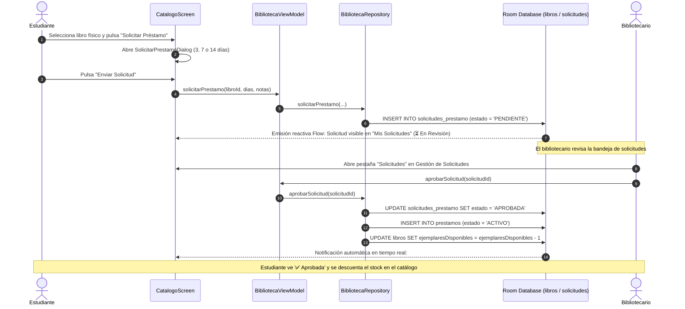
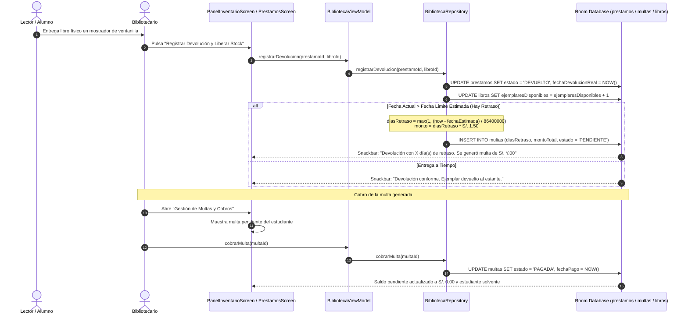
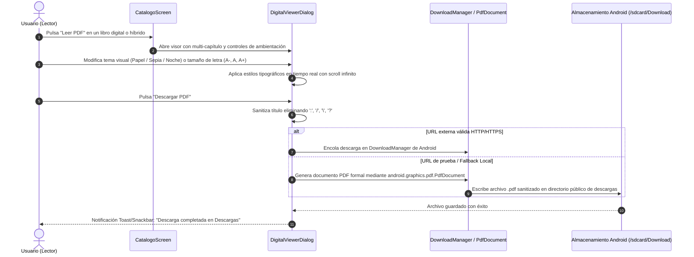

# Arquitectura de Software, Modelo de Datos y Flujos del Sistema
## Sistema Móvil Biblioteca UNAMAD

**Institución:** Universidad Nacional Amazónica de Madre de Dios (UNAMAD)  
**Proyecto:** Aplicación Móvil de Biblioteca Universitaria y Repositorio Digital  
**Versión del Sistema:** 2.0.0 (Producción / Room Database v4)  
**Patrón Arquitectónico:** Clean Architecture + MVVM + Unidirectional Data Flow (UDF)  

---

## 1. Principios y Patrones Arquitectónicos

La aplicación móvil de la Biblioteca UNAMAD está diseñada siguiendo los principios de **Clean Architecture** (Arquitectura Limpia) recomendados por Google para Android, organizada en tres capas concéntricas con desacoplamiento estricto y flujo unidireccional de datos:

```text
┌──────────────────────────────────────────────────────────────────┐
│                     CAPA DE PRESENTACIÓN (UI)                   │
│  Jetpack Compose + Material 3 + Navigation + BibliotecaViewModel │
└─────────────────────────────────┬────────────────────────────────┘
                                  │ Observa StateFlow / Emite Eventos
                                  ▼
┌──────────────────────────────────────────────────────────────────┐
│                     CAPA DE DOMINIO (Domain)                    │
│   Modelos Puros (Libro, Prestamo, Usuario, Solicitud, Multa)     │
└─────────────────────────────────▲────────────────────────────────┘
                                  │ Mapea entidades a dominio
                                  │
┌─────────────────────────────────┴────────────────────────────────┐
│                      CAPA DE DATOS (Data)                        │
│   BibliotecaRepository (SSOT) + SessionManager (SharedPreferences)│
│            Room Database v4 (DAOs + Entities SQLite)             │
└──────────────────────────────────────────────────────────────────┘
```

### 1.1. Separación de Responsabilidades (SoC)
1. **Capa de Presentación (UI Layer):** Implementada exclusivamente en **Jetpack Compose**. Las vistas son funciones composables declarativas y sin estado (`stateless` en su mayoría), que reciben eventos hacia arriba (*events up*) y consumen estado hacia abajo (*state down*).
2. **Capa de Dominio (Domain Layer):** Encapsula las reglas de negocio institucionales (cálculo de mora de S/. 1.50/día, solvencia del lector, disponibilidad de stock físico, plazos de préstamo).
3. **Capa de Datos (Data Layer):** Implementa el patrón **Repository** como la *Fuente Única de Verdad* (SSOT). Abstrae la persistencia relacional local (Room) y las preferencias de sesión (`SessionManager`).

### 1.2. Unidirectional Data Flow (UDF)
El estado de la aplicación fluye en un solo sentido:
- La base de datos SQLite emite cambios reactivos mediante `Flow<T>`.
- El repositorio combina y transforma dichos flujos hacia modelos de dominio.
- El `BibliotecaViewModel` expone estos flujos a través de `StateFlow<UiState>` utilizando el operador `stateIn(viewModelScope, SharingStarted.WhileSubscribed(5000), initialValue)`.
- La UI en Compose se recompone automáticamente ante cada emisión de estado.
- Las acciones del usuario (taps, entradas de texto) son enviadas al ViewModel como llamadas a métodos estándar, ejecutadas en corrutinas de fondo (`Dispatchers.IO`).

---

## 2. Capa de Datos (Data Layer)

### 2.1. Persistencia Relacional con Room Database v4
La base de datos local `biblioteca_database` utiliza **Room 2.7.2** con compilador **KSP**.

#### Entidades SQLite:
1. **`usuarios` (`UsuarioEntity`):** Contiene la información de autenticación institucional y segregación por roles (`ESTUDIANTE` y `BIBLIOTECARIO`). El campo `codigo` posee índice único (`unique = true`).
2. **`libros` (`LibroEntity`):** Catálogo bibliográfico. Incluye control de ejemplares totales (`ejemplaresTotales`) y en estante (`ejemplaresDisponibles`), ubicación física y formatos (`FISICO`, `DIGITAL`, `HIBRIDO`).
3. **`solicitudes_prestamo` (`SolicitudPrestamoEntity`):** Solicitudes de préstamos físicos con llaves foráneas indexadas hacia `usuarios(id)` y `libros(id)`, registrando plazo solicitado, estado y motivo de rechazo dictaminado.
4. **`prestamos` (`PrestamoEntity`):** Préstamos físicos activos y devueltos. Llave foránea hacia `libros(id)`. Incluye fechas UNIX en milisegundos para cálculo de retraso.
5. **`multas` (`MultaEntity`):** Registro de penalizaciones por mora. Llaves foráneas hacia `prestamos(id)` y `usuarios(id)`. Registra días de atraso, importe en soles, fecha de cobro y observaciones de condonación.

### 2.2. Estrategia de Migraciones de Base de Datos
- **Versión 1 ➔ 2 (`MIGRATION_1_2`):** Incorporación de la tabla `usuarios` y columna `usuarioId` en préstamos.
- **Versión 2 ➔ 3 (`MIGRATION_2_3`):** Creación de la tabla `solicitudes_prestamo` con estados y motivos de dictamen.
- **Versión 3 ➔ 4 (`MIGRATION_3_4`):** Creación de la tabla `multas` con campos de mora, cobro y condonación administrativa.

### 2.3. Seeding Inicial (`populateInitialData`)
Al inicializar o recargar la base de datos, se ejecutan de manera transaccional:
- 3 cuentas de usuario institucionales (1 bibliotecario y 2 estudiantes).
- Los **7 libros oficiales de la UNAMAD** con portadas WebP locales vinculadas.
- Préstamos de prueba (Jhordy con préstamo al día, Lucía con préstamo vencido de 2 días).
- Solicitudes iniciales (1 aprobada y 1 pendiente).
- Multa inicial de prueba por retraso en devolución.

---

## 3. Diagrama Entidad-Relación (Mermaid ERD)



---

## 4. Capa de Dominio y Repositorio

El `BibliotecaRepository` centraliza la lógica empresarial y combina fuentes de datos reactivas mediante los operadores `combine` y `map` de Kotlin Flow:

### 4.1. Flujo Agregado: `inventarioConLectores`
Alimenta al **Panel de Base de Datos e Inventario** combinando en tiempo real el acervo bibliográfico con los préstamos físicos que se encuentran fuera de estantería:

```kotlin
val inventarioConLectores: Flow<List<LibroConCirculacion>> = combine(
    todosLosLibros,
    todosLosPrestamos
) { libros, prestamos ->
    val activos = prestamos.filter { it.estado != EstadoPrestamo.DEVUELTO }
    libros.map { libro ->
        val lectoresFisicos = activos.filter { it.libroId == libro.id }
        LibroConCirculacion(
            libro = libro,
            prestamosFisicosActivos = lectoresFisicos
        )
    }
}
```

### 4.2. Flujo Agregado: `estadisticas`
Calcula reactivamente los KPIs del Dashboard institucional:
- Total títulos activos.
- Ejemplares físicos en estante vs. totales.
- Préstamos activos, vencidos y devueltos.
- Solicitudes pendientes por autorizar.
- Multas pendientes y saldo económico por cobrar.

### 4.3. Flujo Agregado: `reporteInstitucional`
Genera las métricas de rendimiento académico e institucional:
- Tasa porcentual de retorno a tiempo.
- Total acumulado de préstamos históricos.
- Total recaudado por multas en ventanilla y monto total condonado.
- Top 5 de libros con mayor circulación.
- Desglose y porcentaje relativo de préstamos por Carrera Profesional.

---

## 5. Capa de Presentación (UI Layer)

### 5.1. Arquitectura de Estado en Jetpack Compose
Cada vista se alimenta de `StateFlow` expuestos por `BibliotecaViewModel`:

```
┌────────────────────────────────────────────────────────┐
│                   BibliotecaViewModel                  │
├────────────────────────────────────────────────────────┤
│ + currentUser: StateFlow<Usuario?>                     │
│ + catalogoUiState: StateFlow<CatalogoUiState>          │
│ + solicitudesUiState: StateFlow<SolicitudesUiState>    │
│ + prestamosUiState: StateFlow<PrestamosUiState>        │
│ + inventarioConLectores: StateFlow<List<LibroCirc...>> │
│ + estadisticas: StateFlow<BibliotecaStats>             │
│ + reporteInstitucional: StateFlow<ReporteInstitucional>│
│ + isPanelInventarioOpen: StateFlow<Boolean>            │
│ + isGestionMultasDialogOpen: StateFlow<Boolean>        │
│ + isReportesDialogOpen: StateFlow<Boolean>             │
│ + isDigitalViewerOpen: StateFlow<Boolean>              │
└───────────────────────────┬────────────────────────────┘
                            │ CollectAsStateWithLifecycle
                            ▼
┌────────────────────────────────────────────────────────┐
│               BibliotecaApp (Compose Router)           │
├────────────────────────────────────────────────────────┤
│ • Si currentUser == null    ➔ LoginScreen              │
│ • Si rol == ESTUDIANTE      ➔ CatalogoEstudiante       │
│                                MisPrestamosEstudiante  │
│                                PerfilEstudiante (Carnet│
│ • Si rol == BIBLIOTECARIO   ➔ CatalogoAdmin (CRUD)     │
│                                GestionSolicitudes      │
│                                PrestamosAdmin          │
│                                DashboardScreen         │
└────────────────────────────────────────────────────────┘
```

### 5.2. Sistema de Diseño y Accesibilidad
- **Soporte Light / Dark:** El tema institucional en `Theme.kt` implementa `DarkColorScheme` configurando `onPrimary = Color.White` y asegurando que los textos dentro de componentes `surfaceVariant` utilicen `MaterialTheme.colorScheme.primary` o `onSurface`, cumpliendo con las pautas de accesibilidad **WCAG AAA** (ratio de contraste superior a 7:1).
- **Tipografía y Legibilidad:** Jerarquías tipográficas claras (`titleLarge`, `titleMedium`, `bodyMedium`, `labelSmall`) con pesos tipográficos marcados (`FontWeight.Bold`, `FontWeight.Black`).

---

## 6. Diagramas de Flujo y Secuencia (Mermaid)

### 6.1. Ciclo de Vida de una Solicitud de Préstamo Físico



---

### 6.2. Devolución Física, Cálculo de Mora y Cobro de Multa



---

### 6.3. Visor Digital Multi-capítulo y Descarga Offline de PDF



---

### 6.4. Auditoría de Base de Datos e Inventario con Lectores en Posesión

```mermaid
sequenceDiagram
    autonumber
    actor B as Bibliotecario
    participant UI as PanelInventarioDatabaseScreen
    participant VM as BibliotecaViewModel
    participant Repo as BibliotecaRepository
    participant DB as Room Database

    B->>UI: Abre "Base de Datos de Inventario y Lectores"
    UI->>VM: Observa StateFlow inventarioConLectores
    VM->>Repo: Flow combine(todosLosLibros, todosLosPrestamosActivos)
    Repo->>DB: SELECT * FROM libros; SELECT * FROM prestamos WHERE estado != 'DEVUELTO'
    DB-->>Repo: Emite listas activas
    Repo-->>VM: Mapea a List<LibroConCirculacion>
    VM-->>UI: Renderiza panel reactivo

    Note over B,UI: Pestaña 0: Registro de Libros
    B->>UI: Toca la tarjeta expandible de un libro
    UI->>UI: Despliega los estudiantes específicos que tienen copias de ese título
    B->>UI: Toca "Devolver" en un alumno específico
    UI->>VM: registrarDevolucion(prestamo, libroId)
    VM->>DB: Libera stock y marca devolución
    DB-->>UI: La tarjeta se actualiza en tiempo real reduciendo lectores y subiendo stock en estante

    Note over B,UI: Pestaña 1: Lectores con Libros en Posesión
    B->>UI: Selecciona pestaña "Lectores con Libros"
    UI->>UI: Muestra todos los alumnos con libros físicos en mano y botón directo de devolución
```
